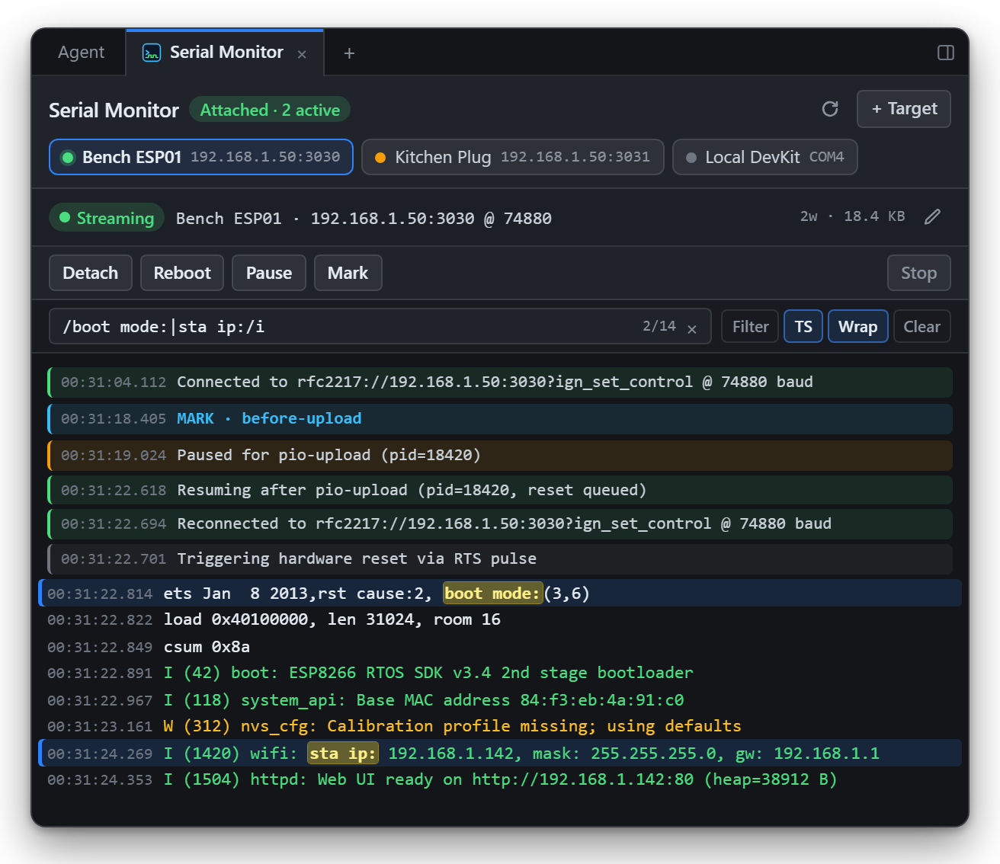
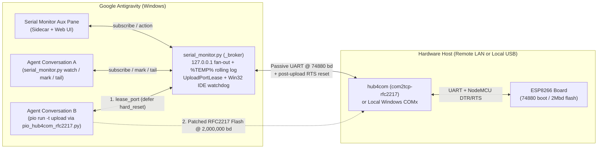

# Antigravity-ESPRemoteSerial

Remote serial flashing (`hub4com` / `RFC2217`), a cooperative multi-client serial monitor broker, and an Auxiliary Side Pane terminal purpose-built for **agentic ESP8266 PlatformIO development in Google Antigravity on Windows**.

<p align="center">
  <picture>
    <source media="(prefers-color-scheme: dark)" srcset="assets/panel-dark.png">
    <source media="(prefers-color-scheme: light)" srcset="assets/panel-light.png">
    
  </picture>
</p>

---

## Why This Exists

Developing ESP8266 firmware with AI agents inside **Google Antigravity** (especially inside a non-Administrator Windows VM where physical boards are hosted over LAN via `hub4com`) hits three painful friction points:

1. **Broken / Slow `hub4com` Flashing in `pyserial` & `esptool`**: Out of the box, `pyserial` fails to negotiate Telnet binary mode with `com2tcp-rfc2217` (corrupting SLIP packets on `0x0D` bytes), wastes ~27 seconds per upload re-negotiating port parameters every time `esptool` touches read `timeout`, and splits NodeMCU `DTR`/`RTS` auto-reset across two TCP packets (booting into normal flash `(3,6)` instead of UART bootloader `(1,7)` over network RTT).
2. **Exclusive Serial Port Contention**: `com2tcp-rfc2217` (and Windows `COMx`) allows only **one** client at a time. A live serial monitor blocks `pio run -t upload`, parallel Antigravity conversations/subagents fight over the port, and closing/reopening a monitor after `esptool --after hard_reset` misses the initial `74880`-baud ESP8266 ROM boot header.
3. **Antigravity Process & Lifecycle Semantics**: Antigravity automatically reaps child processes of short-lived (`IsDaemon = false`) tool calls, while long-lived background daemons must still clean up immediately when the Antigravity IDE closes or when idle so remote `hub4com` ports aren't held indefinitely.

**Antigravity-ESPRemoteSerial** solves all three as a single integrated Antigravity plugin + PlatformIO helper suite:

- **1. Remote Serial Flash Patch ([`tools/pio_hub4com_rfc2217.py`](tools/pio_hub4com_rfc2217.py))**: Drop-in PlatformIO `extra_scripts` post-hook (and `esptool.py` wrapper) that fixes all `hub4com` RFC2217 issues on the client side, flashes reliably up to **`2,000,000` baud** (~3.4× faster), and coordinates zero-drop port handoff + deferred `RTS` reset with the monitor broker so **100% of `74880`-baud ROM boot logs are captured from byte 0**.
- **2. Cooperative Serial Broker & Agent Skill ([`tools/serial_monitor.py`](tools/serial_monitor.py) + [`skills/esp-remote-serial/SKILL.md`](skills/esp-remote-serial/SKILL.md))**: Detached per-board Windows daemon that owns the single `rfc2217://` or `COMx` connection at `74880` baud, fans live logs out over `127.0.0.1` to multiple Antigravity conversations + the UI simultaneously, provides `mark` / `tail --since-mark` checkpoints for agentic test loops, binds to `Antigravity.exe` via a Win32 `SYNCHRONIZE` handle for instant (<100ms) exit on IDE close, and auto-exits after `60s` idle.
- **3. Serial Monitor Extension Panel ([`sidecars/monitor/`](sidecars/monitor/) + [`plugin.json`](plugin.json))**: Antigravity Auxiliary Side Pane terminal that attaches to agent-spawned brokers (or launches new ones), displays live `Flashing (esptool)` handoff status, renders ANSI / `ESP_LOGI`/`W`/`E` colors synced with Antigravity Light & Dark themes, supports target bookmarks/nicknames and one-click hardware `RTS` reboot, and releases its watch lease on tab close or collapse so `60s` broker idle shutdown continues to work.

---

## Architecture



---

## Prerequisites

- **Windows 10 / 11** (standard non-Admin user accounts and VMs fully supported — no `com0com` driver required).
- **Google Antigravity** (provides the Auxiliary Side Pane host and built-in Node sidecar runtime).
- **PlatformIO Core CLI (`pio`)** on Windows (e.g. installed via `uv tool install --python 3.13 platformio` or the official PlatformIO installer, providing `pyserial` and `tool-esptoolpy`).
- *(For remote serial boards)* **`hub4com` (`com2tcp-rfc2217.bat`)** running on the Windows machine with the physical USB-UART dongle — see [**`docs/HUB4COM_SERVER_SETUP.md`**](docs/HUB4COM_SERVER_SETUP.md).

---

## Installation

### Option A: Clone Directly into Antigravity Plugins (Recommended)

```powershell
git clone https://github.com/Adam5Wu/Antigravity-ESPRemoteSerial.git "$HOME\.gemini\config\plugins\serial-monitor"
```

Antigravity automatically loads `plugin.json`, starts the **Serial Monitor** sidecar (`sidecars/monitor/`), and exposes the **`esp-remote-serial`** skill (`skills/esp-remote-serial/SKILL.md`) to your agents.

### Option B: Checkout Elsewhere + Install via `Register-Plugin.ps1`

If you keep the repository in a separate directory (e.g. `Documents\GitHub\Antigravity-ESPRemoteSerial`), sync it into `~/.gemini/config/plugins/serial-monitor`:

```powershell
powershell -ExecutionPolicy Bypass -File .\Register-Plugin.ps1
```

*(Pass `-LinkSource` during active development in a worktree if you want the sidecar to run directly against the checkout's `sidecars/monitor/main.mjs`.)*

---

## Usage in Antigravity & PowerShell

### 1. Opening the Serial Monitor Side Panel

- Click **`+`** in the Antigravity **Auxiliary Side Pane** header → **Serial Monitor** (or ask the agent to *"Open the Serial Monitor side panel"*, which surfaces a clickable `[Serial Monitor](sidecar://serial-monitor/monitor/)` pill).
- Enter a remote `hub4com` host & port (e.g. `192.168.1.50` : `3030` at `74880` baud — `?ign_set_control` is appended automatically) or a local `COM4` port, optionally assign a nickname (e.g. `Bench ESP01`), and click **Connect**.

| UI Control | Behavior |
| :--- | :--- |
| **Target Chips** | Switch between active brokers and saved board bookmarks (`Green` = Streaming, `Amber` = Flashing / Paused, `Pulsing Amber` = Reconnecting, `Gray` = Saved / Idle). |
| **`+ Target` / Pencil (`✎`)** | Add or edit a `host:port @ baud` or `COMx` target bookmark and nickname (stored in `~/.gemini/antigravity/sidecar_data/serial-monitor/monitor/data/state.json`, which agents can also read to resolve board nicknames). |
| **`Start` / `Attach` / `Detach`** | **Start** spawns a detached broker and attaches; **Attach** subscribes to an active broker; **Detach** drops the UI watch lease without stopping the broker. |
| **`Reboot`** | Pulses serial `RTS` (`DTR=0`, `RTS=1` for `100ms` → `RTS=0`) directly over RFC2217/UART to boot cleanly into normal flash mode `(3,6)`. |
| **`Pause` / `Resume`** | Temporarily releases (`5m` safety timeout) or re-acquires the serial port for external tools. |
| **`Mark`** | Inserts `=== [MARK] mark-HHMMSS ===` into the shared log (visible to both UI and agent `tail --since-mark`); **`Shift+Click`** for a custom label. |
| **`Stop`** | Stops the background broker daemon immediately and releases the remote port. |
| **Search + `Filter` Toggle** | Plain text or `/regex/i` search. **`Filter` off** highlights matching lines in context; **`Filter` on** hides non-matching rows. |
| **`TS` / `Wrap` / `Clear`** | Toggle `[HH:MM:SS.mmm]` timestamps, line wrapping, or clear the local viewport without erasing the shared log file. |

---

### 2. PlatformIO Flashing & Direct `esptool` (`pio_hub4com_rfc2217.py`)

> [!IMPORTANT]
> Always append `?ign_set_control` to `rfc2217://<host>:<port>` URLs when targeting `hub4com` (`com2tcp-rfc2217`).

```powershell
$tools = "$HOME\.gemini\config\plugins\serial-monitor\tools"
$env:PLATFORMIO_EXTRA_SCRIPTS = "post:$tools\pio_hub4com_rfc2217.py"
$env:PLATFORMIO_UPLOAD_SPEED  = "2000000"  # Or "921600" if the remote USB-UART adapter caps lower

pio run -t upload   --upload-port "rfc2217://192.168.1.50:3030?ign_set_control"  # Bootloader + partitions + app
pio run -t uploadfs --upload-port "rfc2217://192.168.1.50:3030?ign_set_control"  # LittleFS / SPIFFS image
pio run -t erase    --upload-port "rfc2217://192.168.1.50:3030?ign_set_control"  # Full flash erase
```

*(You can also declare `extra_scripts = post:...` directly inside `platformio.ini`.)*

For standalone `esptool` commands (`flash_id`, `read_mac`, etc.):

```powershell
$py = "$HOME\.platformio\penv\Scripts\python.exe"
& $py "$tools\pio_hub4com_rfc2217.py" `
    --chip esp8266 --port "rfc2217://192.168.1.50:3030?ign_set_control" --baud 921600 flash_id
```

---

### 3. Agentic Serial Monitoring Workflow (`serial_monitor.py`)

With the plugin enabled, Antigravity agents automatically discover [`skills/esp-remote-serial/SKILL.md`](skills/esp-remote-serial/SKILL.md) and follow this cooperative workflow:

```powershell
$py   = "$HOME\.platformio\penv\Scripts\python.exe"
$mon  = "$HOME\.gemini\config\plugins\serial-monitor\tools\serial_monitor.py"
$port = "rfc2217://192.168.1.50:3030?ign_set_control"

# 1. Start live watcher daemon FIRST (in Antigravity: IsDaemon=true, WaitMsBeforeAsync=500)
& $py $mon watch --port $port --label "esp8266-dev"

# 2. Bracket an edit-flash-test or HTTP test action with a named mark
& $py $mon mark "before-test" --port $port
# ... flash firmware or trigger device action ...
& $py $mon tail --since-mark "before-test" --port $port

# 3. Other common operations
& $py $mon tail --lines 50 --port $port       # Inspect recent lines
& $py $mon reboot --capture 4 --port $port    # Clean RTS pulse into (3,6) + capture 4s boot output
& $py $mon status                             # Inspect active brokers, watchers, RX bytes, and marks
& $py $mon stop --port $port                  # Optional manual stop
```

#### Optional Environment Overrides

| Variable | Purpose | Default |
| :--- | :--- | :--- |
| `AGY_SERIAL_PORT` | Default `--port` when omitted on `serial_monitor.py` CLI | *(none)* |
| `SERIAL_MONITOR_PYTHON` | Explicit Python `.exe` override for the UI sidecar | Auto-detected (`pio penv` / `uv` / `python`) |
| `SERIAL_MONITOR_SCRIPT` | Explicit path to `serial_monitor.py` for the UI sidecar | Bundled `tools\serial_monitor.py` |
| `SERIAL_MONITOR_STATE_DIR` | Directory for `mon_*.json` discovery & rolling `logs\` | `%TEMP%\agy_serial_monitor` |

---

## Repository Layout

```text
Antigravity-ESPRemoteSerial/
├── plugin.json                        # Antigravity plugin manifest (`serial-monitor`)
├── Register-Plugin.ps1                # PowerShell shim installer for external checkouts
├── assets/
│   ├── logo.svg                       # Plugin icon
│   ├── panel-dark.png                 # Side panel screenshot (dark theme)
│   └── panel-light.png                # Side panel screenshot (light theme)
├── tools/
│   ├── pio_hub4com_rfc2217.py         # PlatformIO SCons post-hook & esptool RFC2217 patch
│   └── serial_monitor.py              # Cooperative Windows serial broker & CLI (`74880` baud)
├── sidecars/
│   └── monitor/                       # Antigravity Auxiliary Side Pane web UI & sidecar backend
│       ├── package.json
│       ├── sidecar.json
│       ├── main.mjs
│       ├── broker_client.mjs
│       ├── index.html
│       ├── styles.css
│       └── app.js
├── skills/
│   └── esp-remote-serial/
│       └── SKILL.md                   # Bundled Antigravity skill for agentic ESP8266 workflows
└── docs/
    └── HUB4COM_SERVER_SETUP.md        # Windows USB host setup guide for hub4com (com2tcp-rfc2217)
```

---

## License

Released under the [MIT License](LICENSE).
